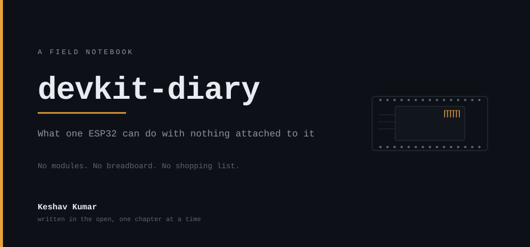

<!--
  The front page of a book, not a repo readme with chapters bolted on.

  Cover and progress bar are SVGs in assets/, drawn by the scripts in scripts/ and committed.
  Nothing on this page is fetched from a chart service at render time.

  There is deliberately no contents page. How many chapters there are is not decided, and a
  numbered list implies it is.
-->

<div align="center">

<picture>
  <source media="(prefers-color-scheme: dark)"  srcset="assets/cover-dark.svg">
  <source media="(prefers-color-scheme: light)" srcset="assets/cover-light.svg">
  
</picture>

<br><br>

<picture>
  <source media="(prefers-color-scheme: dark)"  srcset="assets/progress-dark.svg">
  <source media="(prefers-color-scheme: light)" srcset="assets/progress-light.svg">
  
</picture>

</div>

---

## The premise

Every ESP32 guide starts with a shopping list. A sensor, a display, a breadboard, jumper
wires, and then — eventually — the board itself.

This one never does. Everything in this book runs on a single ESP32 DevKit V1 with **nothing
attached to it**. No modules, no breadboard, no wires. The only thing outside the board that
any chapter touches is a WiFi router, and you already have one of those.

It turns out this is not much of a limitation. Inside that module there is a second radio you
probably have not used, ten pins that sense a hand before it touches them, a third processor
that keeps running after the main two have gone to sleep, and a way to notice someone walking
past on the other side of a wall. Most project guides never reach any of it, because reaching
it does not require buying anything.

## How to read this

**Chapters stand alone.** Start anywhere. Each one says what it does, what the board is
actually doing underneath, the limits it runs into, and where it went wrong.

**The numbers are real.** Capacity, memory and radio figures are read out of the installed
core and its `sdkconfig` rather than repeated from a tutorial, and a chapter says which of its
claims are measured and which are still expectations.

**The failures are kept.** Where a design had to be thrown away, the chapter says so and says
why — the version that was wrong is usually more instructive than the one that works. An
account where nothing goes wrong is not an account of building anything.

**The dead ends are on purpose.** Some of this is about things that do not work: a sensor the
manufacturer deleted, a thermometer that cannot measure a room, the ways this board restarts
without being asked. Knowing where the floor gives way is worth as much as the rest.

**No contents page, and no count.** What gets built depends on what turns out to be
interesting once the board is in front of me. [PROJECTS.md](PROJECTS.md) is the list of ideas
to pick from — what each one does and why, with no code. [HARDWARE.md](HARDWARE.md) is the
board itself.

---

## Colophon

| | |
|---|---|
| Board | ESP32 DevKit V1 — ESP32-WROOM-32, 30-pin |
| Core | arduino-esp32 3.x · *exact version pinned in [HARDWARE.md](HARDWARE.md)* |
| Cover | drawn by `scripts/cover.py`, not photographed |
| Count | drawn by `scripts/progress.py`, counted from `chapters/` rather than hand-kept |
| Licence | MIT — take any of it |

The drawing scripts need Python and nothing else:

```
python scripts/cover.py
python scripts/progress.py
```

Written in the open, one chapter at a time, by **[Keshav Kumar](https://github.com/geekksv)**.
